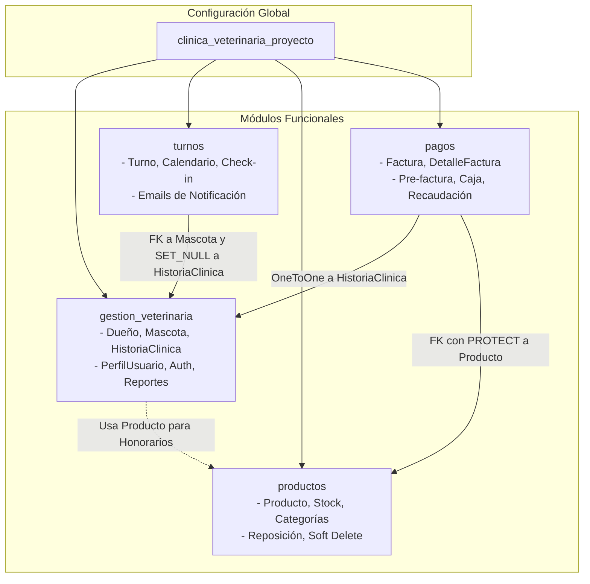
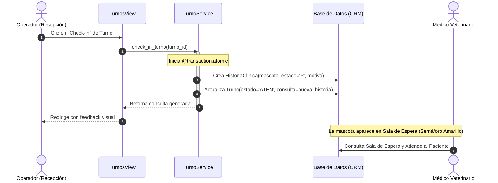
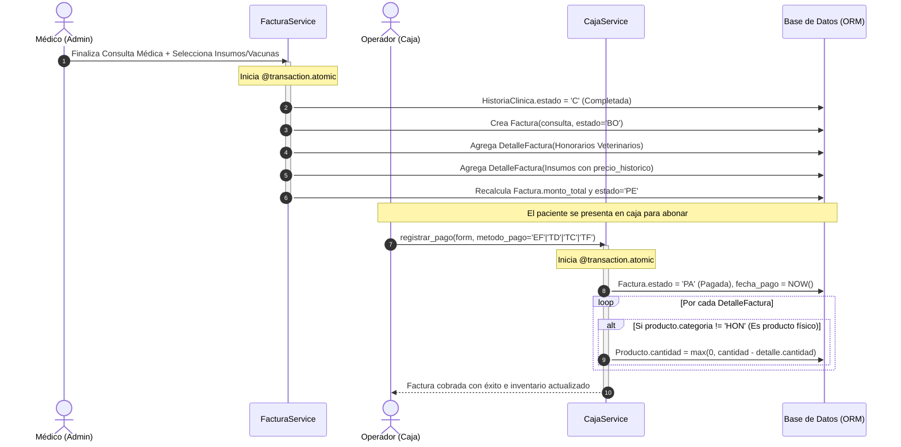
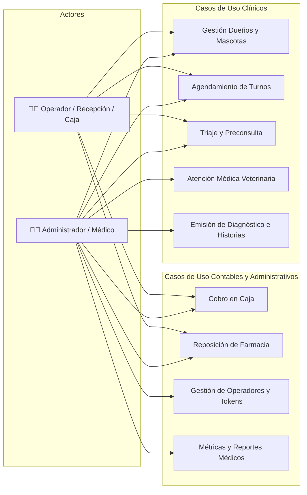

# 📐 Documento de Arquitectura de Software (SAD)
## Sistema de Gestión para Clínica Veterinaria

---

### 📋 Ficha Técnica y Metadatos del Proyecto

* **Proyecto:** Sistema Integral de Gestión para Clínica Veterinaria
* **Cátedra:** PP4 — Proyecto Integrador Final
* **Carrera:** Tecnicatura en Desarrollo de Software
* **Autores:** Sergio Lezcano & Oscar Roth
* **Estilo Arquitectónico:** Monolito Modular con Capa de Servicios (*Service Layer Pattern*)
* **Framework Principal:** Django 4.2 LTS (Python 3.11 / 3.12 / 3.13)
* **Bases de Datos:** MySQL / MariaDB (PyMySQL en Desarrollo) y PostgreSQL (`dj-database-url` en Producción)
* **Control de Versiones y Despliegue:** Git / GitHub / Render Cloud PaaS

---

## 1. 🎯 Introducción y Objetivos Arquitectónicos

### 1.1 Propósito
El sistema provee una solución unificada para la administración médica, operativa y financiera de una clínica veterinaria moderna. Gestiona el ciclo completo del paciente: desde el agendamiento del turno y recordatorio por email, pasando por el triaje, la sala de espera interactiva y la atención médica veterinaria, hasta la pre-facturación automática, el cobro en caja y la deducción atómica de existencias del inventario farmacéutico.

### 1.2 Requerimientos No Funcionales (NFRs)
1. **Mantenibilidad y Limpieza de Código:** Separación estricta de responsabilidades (SoC) evitando la degradación en modelos o vistas sobrecargadas (*Fat Models / Fat Views*).
2. **Consistencia Transaccional (ACID):** Operaciones críticas —como el cobro de una factura y el descuento de stock de múltiples productos— deben ejecutarse de manera atómica e indivisible.
3. **Auditoría e Inmutabilidad Contable:** Los comprobantes de pago deben registrar el precio histórico exacto al momento de la venta, garantizando que futuras actualizaciones de precios en el catálogo no alteren balances financieros pasados.
4. **Seguridad y Control de Acceso basado en Roles (RBAC):** Restricción funcional estricta entre el personal médico/directivo (`ADMINISTRADOR`) y el personal de recepción y caja (`OPERADOR`).
5. **Portabilidad de Entornos:** Capacidad de operar fluidamente en local con drivers 100% Python (sin compilación C++) y en la nube (Render) con bases de datos gestionadas y servicios de mensajería API REST por HTTPS.

---

## 2. 🏛️ Estilo Arquitectónico: Monolito Modular con Service Layer

El sistema adopta el patrón **Monolito Modular con Capa de Servicios (*Service Layer Pattern*)**.

```
┌─────────────────────────────────────────────────────────────┐
│                   CAPA DE PRESENTACIÓN                      │
│     Templates HTML5 (DTL) + CSS Centralizado + FullCalendar │
└──────────────────────────────┬──────────────────────────────┘
                               │ HTTP Request / Forms
                               ▼
┌─────────────────────────────────────────────────────────────┐
│              CAPA DE CONTROL (Thin Views)                   │
│           Django Views: Autenticación y Despacho            │
└──────────────────────────────┬──────────────────────────────┘
                               │ Invocación de Métodos de Servicio
                               ▼
┌─────────────────────────────────────────────────────────────┐
│          CAPA DE SERVICIOS (Lógica de Negocio Pura)         │
│  AuthService │ MascotaService │ FacturaService │ CajaService │
│  TurnoService│ ProductoService│ UsuarioService │ etc.       │
└──────────────────────────────┬──────────────────────────────┘
                               │ Consultas / Transacciones ORM
                               ▼
┌─────────────────────────────────────────────────────────────┐
│             CAPA DE DOMINIO Y ACCESO A DATOS                │
│         Django ORM: Modelos, Constraints y Relaciones       │
└──────────────────────────────┬──────────────────────────────┘
                               │ SQL Queries
                               ▼
┌─────────────────────────────────────────────────────────────┐
│                 INFRAESTRUCTURA Y DATOS                     │
│      MySQL / MariaDB (Local)  │  PostgreSQL (Cloud Render)  │
│      Anymail + Resend (Email) │  WhiteNoise (Static Files)  │
└─────────────────────────────────────────────────────────────┘
```

### ¿Por qué esta arquitectura?
* **Frente a Django MVT clásico:** En aplicaciones medianas o complejas, alojar la lógica de negocio en las vistas (*views.py*) genera código duplicado e imposible de testear independientemente del ciclo HTTP. A su vez, colocar lógica transaccional o de negocio compleja en los modelos (*fat models*) genera dependencias circulares entre aplicaciones. La **Capa de Servicios (*Service Layer*)** extrae y centraliza las reglas de negocio en clases de servicio cohesivas, dejando las vistas reducidas a meros orquestadores HTTP (*Thin Views*).
* **Frente a Microservicios:** En este estadio, una arquitectura de microservicios añadiría complejidad innecesaria (latencia de red, serialización distribuida, fallas de red y orquestación de transacciones distribuidas SAGA). El monolito modular conserva la simplicidad de despliegue y la garantía de transacciones ACID en base de datos única, pero manteniendo fronteras de dominio claramente separadas.

---

## 3. 🧩 Modelo 4+1 Vistas de Philippe Kruchten

### 3.1 Vista Lógica (Logical View)

Organiza las responsabilidades del sistema en capas horizontales claramente desacopladas:

1. **Capa de Presentación (UI):**
   * Plantillas HTML5 con Django Template Language (DTL).
   * Hoja de estilos centralizada y normalizada (`estilos.css`) con diseño responsive mediante CSS Grid y Flexbox.
   * Componentes dinámicos cliente: FullCalendar v6 (CDN) y JavaScript vanilla para modales e interacción rápida.
2. **Capa de Controladores / Vistas Delgadas (*Thin Views*):**
   * Reciben la solicitud HTTP (`HttpRequest`).
   * Validan la autenticación y permisos del usuario (`@login_required`, validación de rol `ADMIN` u `OPER`).
   * Instancian formularios Django (`forms.py`) para sanitización y validación de entrada.
   * Delegan la ejecución a la **Capa de Servicios**.
   * Retornan respuestas HTTP, redirecciones (`redirect`) o respuestas JSON asíncronas para el calendario.
3. **Capa de Servicios (*Service Layer*):**
   * Orquestación de casos de uso complejos.
   * Manejo de transacciones ACID con decorador `@transaction.atomic`.
   * Integración con servicios de mensajería (despacho de correos HTML con Resend).
   * Cálculos de negocio (cálculo de edad dinámica, estado de inventario, stock crítico, métricas de consultorio).
4. **Capa de Datos y Modelos de Dominio (Django ORM):**
   * Definición declarativa del esquema de base de datos.
   * Claves primarias, foráneas, restricciones de unicidad (`UniqueConstraint`) y reglas de integridad referencial (`PROTECT`, `CASCADE`, `SET_NULL`).
   * Métodos y propiedades encapsuladas de entidad (`@property edad`, `@property estado_stock`, `actualizar_total()`).
5. **Capa de Infraestructura Externa:**
   * Motores de base de datos relacionales: MySQL / PostgreSQL.
   * Servidor WSGI: Gunicorn.
   * Servidor de archivos estáticos: WhiteNoise v6 con compresión y versionado por hash.
   * Conector de correos: Django Anymail con API HTTPS de Resend.

---

### 3.2 Vista de Desarrollo / Componentes (Development View)

El sistema se divide en **4 módulos funcionales cohesivos** más el paquete de configuración central:



#### Catálogo de Servicios por Módulo:

| Módulo | Servicio | Responsabilidad Primaria |
| :--- | :--- | :--- |
| **`gestion_veterinaria`** | `AuthService` | Autenticación, redirección dinámica según rol y guardias de seguridad. |
| | `UsuarioService` | Alta de operadores, generación de token criptográfico (`urlsafe_base64_encode`) y envío de invitación. |
| | `MascotaService` | Cálculo dinámico de edad (meses/años) y validación de pacientes vinculados a dueños. |
| | `HistoriaService` | Gestión del semáforo de atención (Pendiente, Completada, Cancelada), preconsulta y triaje. |
| | `ReporteService` | Computación de métricas de consultorio, top de especies y movimiento del día. |
| **`productos`** | `ProductoService` | Métricas de catálogo, stock crítico, reposición por lotes, ventas acumuladas y borrado lógico (*soft delete*). |
| **`pagos`** | `FacturaService` | Creación de pre-factura automática al cerrar consulta, agregado de honorarios e insumos y precio histórico. |
| | `CajaService` | Registro del cobro de facturas y **descuento automático y atómico de stock**. |
| **`turnos`** | `TurnoService` | Generación de eventos JSON para FullCalendar, check-in 1-clic a sala de espera y despacho de correos transaccionales. |

---

### 3.3 Vista de Procesos / Dinámica (Process View)

#### Proceso 1: Check-in de Paciente con Turno hacia Sala de Espera Médica



---

#### Proceso 2: Atención Médica, Pre-facturación y Cobro en Caja con Descuento Atómico de Stock



---

### 3.4 Vista Física y de Despliegue (Physical View)

El sistema soporta despliegue bidireccional: un entorno local de desarrollo de cero dependencias externas y un entorno productivo en la nube basado en contenedores/PaaS en **Render Cloud**:

```mermaid
graph TD
    subgraph Cliente
        BROWSER[Navegador Web / Dispositivo Móvil]
    end

    subgraph Entorno de Producción (Render Cloud)
        ROUTER[Proxy Reverso HTTPS Cloudflare / Render]
        WSGI[Gunicorn WSGI Server]
        DJANGO[Aplicación Django 4.2 LTS]
        STATIC[WhiteNoise v6 con Almacenamiento Comprimido]
        PG[(PostgreSQL Database Administrada)]
    end

    subgraph Servicios Cloud Externos
        RESEND[API REST Resend - Puerto HTTPS 443]
    end

    BROWSER -->|HTTPS :443| ROUTER
    ROUTER -->|Reverse Proxy| WSGI
    WSGI --> DJANGO
    DJANGO --> STATIC
    DJANGO -->|dj-database-url / TCP 5432| PG
    DJANGO -->|HTTPS REST API / JSON| RESEND
```

#### Estrategia Dual de Infraestructura:

| Componente | Entorno Local (Desarrollo) | Entorno Render Cloud (Producción) |
| :--- | :--- | :--- |
| **Servidor Web / WSGI** | Django `runserver` | Gunicorn 21.2+ multiproceso |
| **Archivos Estáticos** | Django `StaticFilesHandler` | WhiteNoise 6.6+ con `CompressedManifestStaticFilesStorage` |
| **Base de Datos** | MySQL / MariaDB vía `PyMySQL` | PostgreSQL administrada vía `psycopg2-binary` y `dj-database-url` |
| **Servicio de Email** | Consola de depuración (`console.EmailBackend`) | API REST HTTPS vía `django-anymail[resend]` |
| **Automatización Build** | Manual (`migrate`, `runserver`) | Script automatizado [`build.sh`](file:///d:/TEC%20DESARROLLO%20EN%20SOFTWARE/4to%20CUATRIMESTRE/BACKEND/PROYECTO%20BACKEND/clinica_veterinaria/build.sh) |

---

### 3.5 Vista de Escenarios y Casos de Uso (Use Case View)

#### Matriz de Control de Acceso por Roles (RBAC):



---

## 4. 🗄️ Modelo de Datos e Integridad Referencial

### 4.1 Diagrama Entidad-Relación Completo (Mermaid)

```mermaid
erDiagram
    DUEÑO ||--o{ MASCOTA : "posee (1 a N)"
    MASCOTA ||--o{ HISTORIA_CLINICA : "registra historial (1 a N)"
    MASCOTA ||--o{ TURNO : "agenda citas (1 a N)"
    HISTORIA_CLINICA ||--o| FACTURA : "genera facturación (1 a 1)"
    HISTORIA_CLINICA ||--o| TURNO : "se vincula por check-in (1 a 1)"
    FACTURA ||--o{ DETALLE_FACTURA : "posee líneas de detalle (1 a N)"
    PRODUCTO ||--o{ DETALLE_FACTURA : "es referenciado en (1 a N)"
    USER ||--o| PERFIL_USUARIO : "extiende perfil y rol (1 a 1)"

    DUEÑO {
        int id PK
        string nombre "max: 100"
        string apellido "max: 100"
        string telefono "max: 20"
        string email UK "max: 254"
    }

    MASCOTA {
        int id PK
        int dueño_id FK "CASCADE"
        string nombre "max: 50"
        string especie "max: 50"
        string raza "max: 50"
        string sexo "M: Macho | H: Hembra"
        date fecha_nacimiento "nullable"
    }

    HISTORIA_CLINICA {
        int id PK
        int mascota_id FK "CASCADE"
        datetime fecha_consulta "auto_now_add"
        string estado "P: Pendiente | C: Completada | X: Cancelada"
        text motivo
        decimal peso "5 dig, 2 dec"
        decimal temperatura "4 dig, 1 dec"
        text diagnostico
        text tratamiento
        text observaciones
    }

    PRODUCTO {
        int id PK
        string nombre UK "max: 100"
        string categoria "MED | VAC | INS | HON"
        decimal precio_unitario "10 dig, 2 dec"
        int cantidad "PositiveIntegerField"
        bool activo "Soft-delete flag"
    }

    FACTURA {
        int id PK
        int consulta_id FK_UK "OneToOne, CASCADE"
        datetime fecha_emision "auto_now_add"
        datetime fecha_pago "nullable"
        string estado "BO: Borrador | PE: Pendiente | PA: Pagado | CA: Cancelado"
        string metodo_pago "EF | TD | TC | TF"
        decimal monto_total "10 dig, 2 dec"
    }

    DETALLE_FACTURA {
        int id PK
        int factura_id FK "CASCADE"
        int producto_id FK "PROTECT"
        int cantidad "PositiveIntegerField"
        decimal precio_historico "Inmutable al crear"
        decimal subtotal "cantidad * precio_historico"
    }

    TURNO {
        int id PK
        int mascota_id FK "CASCADE"
        int consulta_id FK_UK "SET_NULL, nullable"
        datetime fecha_hora
        string estado "PEN | CONF | ATEN | CANC"
        text motivo
        bool notificado_email
        text observaciones
    }

    PERFIL_USUARIO {
        int id PK
        int user_id FK_UK "OneToOne, CASCADE"
        string rol "ADMIN: Administrador | OPER: Operador"
    }
```

### 4.2 Reglas Críticas de Integridad y Diseño de Datos

1. **Relación 1 a N Multi-Mascota:** Un propietario puede poseer varias mascotas, cada una con su historial clínico y turnos independientes. La eliminación del dueño propaga `CASCADE` sobre sus mascotas.
2. **Inmutabilidad Contable (*Snapshot Pattern*):** `DetalleFactura` captura `precio_historico = producto.precio_unitario` en el método `save()`. Si el precio del catálogo sube posteriormente, las facturas pasadas conservan su valor original inalterado.
3. **Protección de Integridad Referencial (*PROTECT*):** La relación entre `DetalleFactura` y `Producto` utiliza `on_delete=models.PROTECT`. Esto impide que un producto sea eliminado de la base de datos si ya fue facturado en el pasado.
4. **Borrado Lógico (*Soft Delete*):** Los productos cuentan con el campo booleano `activo`. Al desactivar un producto se oculta de la selección para nuevas consultas pero se preserva intacto el historial comercial y clínico.
5. **Vínculo Seguro Turno-Consulta (`SET_NULL`):** Si una historia clínica es cancelada o eliminada, el turno histórico se preserva con `consulta_id = NULL`, manteniendo la auditoría de citas.

---

## 5. 🛠️ Patrones de Diseño de Software Implementados

| Patrón | Tipo | Ubicación en el Código | Justificación Arquitectónica |
| :--- | :--- | :--- | :--- |
| **Service Layer** | Arquitectónico | `*/services/*.py` | Desacopla reglas de negocio de los controladores HTTP y modelos ORM. |
| **Repository / Active Record** | Acceso a Datos | Django ORM (`models.Model`) | Mapeo objeto-relacional tipado con consultas optimizadas (`select_related`). |
| **Unit of Work / Transaction Script** | Comportamiento | `@transaction.atomic` en `caja_service.py` y `factura_service.py` | Garantiza consistencia ACID; revierte toda la operación si falla un descuento de stock. |
| **Snapshot / Memento** | Creacional/Estructural | `DetalleFactura.precio_historico` | Congela el valor monetario del producto al momento de emitir el comprobante. |
| **Adapter / Strategy** | Estructural | Conmutación de `EMAIL_BACKEND` | Conmuta entre salida por consola en local y API REST HTTPS de Resend en producción sin alterar el código de los servicios. |
| **RBAC (Role-Based Access Control)** | Seguridad | `PerfilUsuario.Rol` + `@login_required` + `AuthService` | Segmenta el acceso a funciones médicas y administrativas según el rol del usuario. |
| **Token Generator** | Seguridad Criptográfica | `UsuarioService` con `default_token_generator` | Genera enlaces seguros y de un solo uso para que nuevos operadores configuren su contraseña. |

---

## 6. 🛡️ Estrategia de Calidad y Pruebas (Test Suite)

El proyecto incluye pruebas automatizadas que cubren las reglas de negocio de los servicios y modelos:

```bash
python manage.py test
```

### Cobertura por Módulo:
* **`gestion_veterinaria.tests`:** Cálculo de edad dinámica en meses y años, validación de fechas futuras, ciclo de vida de salas de espera y triaje de preconsulta.
* **`productos.tests`:** Umbrales de stock bajo ($\le 5$), detección de agotado, exclusión lógica de honorarios en el inventario y reposición por lotes.
* **`pagos.tests`:** Generación de comprobantes en borrador, cobro en caja con descuento atómico de existencias y comprobación de inmutabilidad del precio histórico.
* **`turnos.tests`:** Check-in 1-clic a sala médica, serialización de eventos JSON para FullCalendar y cancelación de citas.

---

## 7. 🚀 Conclusiones Arquitectónicas

La arquitectura implementada resuelve de manera elegante y profesional las necesidades de una clínica veterinaria moderna:
1. **Desacoplamiento Efectivo:** Al aislar la lógica en la **Capa de Servicios**, el sistema queda listo para evolucionar sin fricción hacia una API REST (ej. Django REST Framework) o consumir clientes móviles nativos sin reescribir la lógica de negocio.
2. **Seguridad y Robustez Transaccional:** El uso sistemático de transacciones atómicas y restricciones a nivel de base de datos previene discrepancias de inventario y errores de concurrencia.
3. **Escalabilidad y Bajo Coste Operativo:** La separación entre desarrollo con SQLite/MySQL y producción con PostgreSQL y WhiteNoise garantiza despliegues reproducibles, económicos y de alto rendimiento en la nube.
