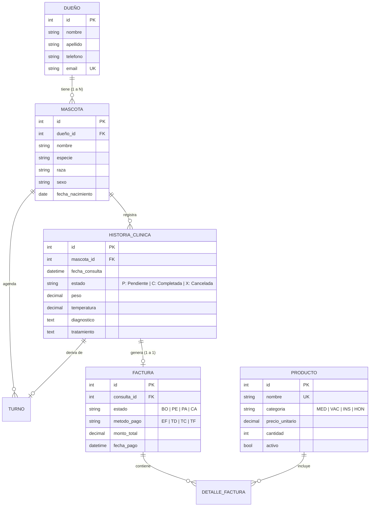

# 🐾 Sistema de Gestión para Clínica Veterinaria


-4479A1?logo=mysql&logoColor=white)


Sistema web integral desarrollado como proyecto académico para la **Tecnicatura en Desarrollo de Software (Proyecto Integrador Final)**. Su objetivo es centralizar y optimizar los procesos operativos, clínicos, farmacéuticos y financieros de una clínica veterinaria moderna.

---

## 📑 Tabla de Contenidos

- [Características Principales](#-características-principales)
  - [1. Núcleo Clínico y Recepción (`gestion_veterinaria`)](#1-núcleo-clínico-y-recepción-gestion_veterinaria)
  - [2. Farmacia y Control de Stock (`productos`)](#2-farmacia-y-control-de-stock-productos)
  - [3. Facturación, Caja y Punto de Venta (`pagos`)](#3-facturación-caja-y-punto-de-venta-pagos)
  - [4. Agenda de Citas y Turnos (`turnos`)](#4-agenda-de-citas-y-turnos-turnos)
  - [5. Gestión de Operadores e Invitación por Email](#5-gestión-de-operadores-e-invitación-por-email)
  - [6. Panel de Reportes y Estadísticas](#6-panel-de-reportes-y-estadísticas)
  - [7. Diseño Responsive y UI Normalizada](#7-diseño-responsive-y-ui-normalizada)
- [Arquitectura de Software (Service Layer)](#-arquitectura-de-software-service-layer)
- [Modelo de Datos y Multi-Mascota](#-modelo-de-datos-y-multi-mascota)
- [Tecnologías y Dependencias](#-tecnologías-y-dependencias)
- [Estructura del Proyecto](#-estructura-del-proyecto)
- [Instalación y Puesta en Marcha Local](#-instalación-y-puesta-en-marcha-local)
- [Configuración de Correo Electrónico](#-configuración-de-correo-electrónico)
- [Guía de Despliegue en Render (Cloud)](#-guía-de-despliegue-en-render-cloud)
- [🧪 Pruebas Automatizadas (Unit Tests)](#-pruebas-automatizadas-unit-tests)
- [Roles de Usuario y Flujo de Atención](#-roles-de-usuario-y-flujo-de-atención)
- [Equipo de Desarrollo](#-equipo-de-desarrollo)
- [Licencia](#-licencia)

---

## 🌟 Características Principales

### 1. Núcleo Clínico y Recepción (`gestion_veterinaria`)
* **Gestión de Propietarios y Pacientes:** Registro integral con validación de datos de contacto. Soporta múltiples mascotas por cada propietario (relación 1:N).
* **Cálculo de Edad en Tiempo Real:** La edad de la mascota se computa automáticamente en meses y años según su fecha de nacimiento (`MascotaService`).
* **Preconsulta y Triaje Inicial:** El operador registra signos vitales iniciales (peso, temperatura, motivo de consulta) antes de la derivación médica.
* **Sala de Espera Interactiva:** Semáforo de estados en vivo (`Pendiente`, `Completada`, `Cancelada`) para que los veterinarios atiendan a los pacientes en orden de llegada.
* **Historia Clínica Digitalizada:** Registro cronológico de diagnósticos, tratamientos, evoluciones y recetas de cada paciente con control de acceso médico.
* **Control de Acceso por Roles (RBAC):** Separación estricta de permisos entre `ADMINISTRADOR` (médico/director) y `OPERADOR` (recepción y caja).

### 2. Farmacia y Control de Stock (`productos`)
* **Catálogo Organizado:** Clasificación en 4 categorías normadas:
  * 💊 `MED` - Medicamentos
  * 💉 `VAC` - Vacunas
  * 🩺 `INS` - Insumos Clínicos
  * 📋 `HON` - Honorarios y Servicios Veterinarios
* **Control Inteligente de Inventario (`ProductoService`):**
  * Estados dinámicos: `DISPONIBLE`, `BAJO STOCK` (cantidad $\le 5$) y `AGOTADO` ($= 0$).
  * Exclusión lógica de honorarios/servicios del cálculo de inventario físico.
  * Cálculo en tiempo real de valor total del inventario y total histórico de unidades vendidas.
* **Modales de Reposición Directa:** Actualización rápida de existencias en dos modalidades: incremental (sumar unidades) o ajuste absoluto de inventario.
* **Borrado Lógico (*Soft Delete*):** Permite pausar o reactivar productos descontinuados sin romper la integridad referencial de comprobantes contables pasados.

### 3. Facturación, Caja y Punto de Venta (`pagos`)
* **Pre-facturación Automática:** Al finalizar la atención médica se genera automáticamente un comprobante en estado `BORRADOR` vinculado a la consulta.
* **Cómputo Automático de Honorarios e Insumos:** Incorporación de conceptos facturables directamente desde el catálogo de productos y servicios.
* **Descuento Automático de Stock:** Al registrarse el pago de una factura en caja (`PA`), el sistema descuenta automáticamente las unidades consumidas del inventario físico.
* **Gestión de Medios de Pago:** Registro y validación de cobro en Efectivo (`EF`), Tarjeta de Débito (`TD`), Tarjeta de Crédito (`TC`) y Transferencia Bancaria (`TF`).
* **Inmutabilidad de Precios:** Guarda el `precio_historico` al momento exacto de la emisión para garantizar auditoría contable ante futuras variaciones de precios.

### 4. Agenda de Citas y Turnos (`turnos`)
* **Calendario Dinámico e Interactivo:** Integración con **FullCalendar v6** con vistas mensual, semanal y diaria, soporte de franjas horarias y eventos codificados por color según el estado (`Pendiente`, `Confirmado`, `Atendido`, `Cancelado`).
* **Check-in en 1 Clic a Sala de Espera:** Al presentarse el paciente en recepción, un solo botón marca el turno como `Atendido` y genera inmediatamente su entrada en la Sala de Espera médica.
* **Notificaciones Transaccionales por Email:** Envío automático de correo HTML con los detalles de la cita al registrar o confirmar un turno.
* **Arquitectura Híbrida de Email:** Emite por consola en desarrollo y mediante API HTTPS con **Resend** en entornos cloud como Render.

### 5. Gestión de Operadores e Invitación por Email
* **Alta Simplificada de Operadores:** El administrador puede crear nuevos usuarios del personal de recepción desde la interfaz administrativa del sistema.
* **Activación por Token Criptográfico Seguro:** Generación automática de enlace tokenizado (`urlsafe_base64_encode` + `default_token_generator`) enviado por correo electrónico para que el operador establezca su contraseña.
* **Reenvío y Control de Acceso:** Posibilidad de reenviar el correo de activación o desactivar/activar cuentas de operadores en tiempo real.

### 6. Panel de Reportes y Estadísticas
* **Métricas Clínicas:** Resumen consolidado de consultas atendidas, pacientes en espera y cancelaciones.
* **Movimiento del Día:** Indicador de actividad diaria para seguimiento operativo.
* **Top de Especies Atendidas:** Ranking de especies más frecuentes tratadas en la clínica con cálculo porcentual.

### 7. Diseño Responsive y UI Normalizada
* **Hoja de Estilos Centralizada (`estilos.css`):** Eliminación total de bloques `<style>` repetitivos en los templates HTML, facilitando el mantenimiento y garantizando coherencia visual.
* **Compatibilidad Multi-Dispositivo:** Adaptación fluida mediante media queries para teléfonos móviles, tablets y pantallas de escritorio.
* **Componentes Adaptativos:** Grillas elásticas, tablas con desplazamiento horizontal (`.table-responsive`), botones con zonas táctiles óptimas y modales accesibles.

---

## 🏛️ Arquitectura de Software (Service Layer)

El proyecto implementa el patrón **Service Layer (Capa de Servicios)** para desacoplar la lógica de negocio de las vistas y modelos de Django, garantizando mantenibilidad, reusabilidad y facilidad de pruebas:

```text
clinica_veterinaria/
├── gestion_veterinaria/services/
│   ├── auth_service.py       # Redirección por roles (ADMINISTRADOR vs OPERADOR)
│   ├── usuario_service.py    # Invitación, alta y reseteo de claves de operadores
│   ├── mascota_service.py    # Cálculo de edad dinámica y gestión de pacientes
│   ├── historia_service.py   # Flujo de preconsulta, triaje y sala de espera
│   └── reporte_service.py    # Estadísticas, totales y métricas de atención
│
├── productos/services/
│   └── producto_service.py   # Métricas de inventario, filtros, stock y soft delete
│
├── pagos/services/
│   ├── factura_service.py    # Pre-factura automática, precios históricos y detalles
│   └── caja_service.py       # Cobro de facturas y descuento automático de stock
│
└── turnos/services/
    └── turno_service.py      # Eventos FullCalendar, check-in 1-clic y emails HTML
```

> 📖 **Documento Completo de Arquitectura:** Para una descripción técnica detallada según el **Modelo 4+1 Vistas**, diagramas de secuencia transaccionales, topología física y catálogo de patrones de diseño, consulta el documento formal: [ARQUITECTURA.md](file:///d:/TEC%20DESARROLLO%20EN%20SOFTWARE/4to%20CUATRIMESTRE/BACKEND/PROYECTO%20BACKEND/clinica_veterinaria/ARQUITECTURA.md).

---

## 🗄️ Modelo de Datos y Multi-Mascota

El sistema está diseñado para que **un mismo dueño pueda tener múltiples mascotas**. Cada mascota mantiene su propio historial clínico, turnos y preconsultas independientes:



---

## 🛠️ Tecnologías y Dependencias

### Backend
- **Lenguaje:** Python 3.11 / 3.12 / 3.13
- **Framework:** Django 4.2 LTS
- **Bases de Datos:**
  - **Desarrollo:** MySQL / MariaDB mediante `PyMySQL` (driver 100% Python, sin necesidad de compilar conectores C++ en Windows/Linux).
  - **Producción:** PostgreSQL administrada mediante `dj-database-url` y `psycopg2-binary`.
- **Servidor WSGI (Producción):** Gunicorn 21.2+
- **Archivos Estáticos:** WhiteNoise 6.6+ con `CompressedManifestStaticFilesStorage`
- **Email Transaccional:** `django-anymail[resend]` (comunicación segura por HTTPS puerto 443 sin bloqueos SMTP)

### Frontend
- **Estructura:** HTML5 semántico con plantillas Django DTL
- **Estilos:** CSS3 nativo centralizado (`estilos.css`), Flexbox y CSS Grid
- **Librerías:** FullCalendar v6 (CDN), Bootstrap Icons

### Dependencias del Proyecto (`requirements.txt`)
```text
Django==4.2
asgiref==3.11.1
sqlparse==0.5.5
tzdata==2026.2
django-anymail[resend]<=12.0
gunicorn>=21.2.0
whitenoise>=6.6.0
dj-database-url>=2.1.0
psycopg2-binary>=2.9.9
PyMySQL>=1.1.0
```

> **Nota técnica:** Gracias a la configuración en `clinica_veterinaria_proyecto/__init__.py` (`pymysql.install_as_MySQLdb()`), el proyecto utiliza `PyMySQL` como backend de MySQL, eliminando por completo los errores de compilación habituales de `mysqlclient`.

---

## 📁 Estructura del Proyecto

```text
clinica_veterinaria/
├── build.sh                         # Script de construcción y migración para Render
├── requirements.txt                 # Dependencias completas (local + cloud)
├── manage.py                        # CLI de gestión de Django
├── README.md                        # Documentación integral del sistema
│
├── clinica_veterinaria_proyecto/    # Configuración global del proyecto
│   ├── __init__.py                  # Inicialización y vinculación de PyMySQL
│   ├── settings.py                  # Variables, DB (MySQL/PostgreSQL), Email y WhiteNoise
│   ├── urls.py                      # Enrutamiento raíz
│   └── wsgi.py                      # Punto de entrada para Gunicorn/Render
│
├── gestion_veterinaria/             # Módulo Central Clínico, Usuarios y Reportes
│   ├── models.py                    # Dueño, Mascota, HistoriaClinica, PerfilUsuario
│   ├── views.py                     # Vistas de preconsulta, sala de espera, operadores
│   ├── urls.py                      # Rutas de pacientes, médicos y reportes
│   ├── forms.py                     # Formularios de alta y preconsulta
│   ├── tests.py                     # Pruebas unitarias de gestión clínica y auth
│   ├── services/                    # Capa de servicios desacoplada
│   │   ├── auth_service.py          # Lógica de login y ruteo según rol
│   │   ├── usuario_service.py       # Alta de operadores y confirmación por correo
│   │   ├── mascota_service.py       # Validación y cálculo dinámico de edad
│   │   ├── historia_service.py      # Ciclo de consultas y sala de espera
│   │   └── reporte_service.py       # Métricas y estadísticas de atención
│   ├── static/gestion/css/
│   │   └── estilos.css              # Hoja de estilos centralizada y responsive
│   └── templates/gestion/           # Vistas de interfaz de usuario
│
├── productos/                       # Módulo de Farmacia e Inventario
│   ├── models.py                    # Producto con cálculo de stock y categorías
│   ├── views.py                     # Catálogo, reposición, métricas y filtros
│   ├── forms.py                     # Formularios de productos y ajustes
│   ├── urls.py                      # Rutas de farmacia e inventario
│   ├── tests.py                     # Pruebas de stock, alertas y soft delete
│   ├── services/
│   │   └── producto_service.py      # Lógica de catálogo, inventario y ventas
│   └── templates/productos/         # Plantillas de farmacia
│
├── pagos/                           # Módulo de Caja y Facturación
│   ├── models.py                    # Factura, DetalleFactura (precio histórico)
│   ├── views.py                     # Pre-factura, cobro de caja y reportes
│   ├── urls.py                      # Rutas de facturación y pago
│   ├── tests.py                     # Pruebas de facturación y stock automático
│   ├── services/
│   │   ├── factura_service.py       # Pre-facturación automática y honorarios
│   │   └── caja_service.py          # Cobro y descuento automático de stock
│   └── templates/pagos/             # Plantillas de facturas y cobros
│
└── turnos/                          # Módulo de Agenda y Notificaciones
    ├── models.py                    # Turno con estado y vinculación a HistoriaClinica
    ├── views.py                     # Calendario interactivo, check-in, API JSON
    ├── urls.py                      # Rutas de agenda y API para FullCalendar
    ├── tests.py                     # Pruebas de turnos, check-in y agenda
    ├── services/
    │   └── turno_service.py         # Lógica de turnos, eventos y emails HTML
    └── templates/turnos/            # Interfaz de FullCalendar y registro de citas
```

---

## 🚀 Instalación y Puesta en Marcha Local

### 1. Requisitos Previos
- Python 3.11, 3.12 o 3.13 instalado.
- Servidor MySQL o MariaDB (por ejemplo XAMPP, WampServer o servicio local en el puerto 3306).
- Git.

### 2. Clonar el Repositorio
```bash
git clone https://github.com/SergioLezcano/Clinica_Veterinaria.git
cd Clinica_Veterinaria
```

### 3. Crear y Activar el Entorno Virtual

**En Windows (PowerShell):**
```powershell
python -m venv venv
.\venv\Scripts\Activate.ps1
```

**En Windows (CMD):**
```cmd
python -m venv venv
venv\Scripts\activate.bat
```

**En Linux / macOS:**
```bash
python3 -m venv venv
source venv/bin/activate
```

### 4. Instalar Dependencias
```bash
pip install -r requirements.txt
```

### 5. Configurar la Base de Datos Local
1. Inicie su servidor MySQL y cree la base de datos vacía:
   ```sql
   CREATE DATABASE clinica_veterinaria CHARACTER SET utf8mb4 COLLATE utf8mb4_unicode_ci;
   ```
2. La configuración por defecto en `clinica_veterinaria_proyecto/settings.py` conecta a `127.0.0.1:3306` con usuario `root` y sin contraseña. Modifíquela si su instalación local lo requiere:
   ```python
   DATABASES = {
       'default': {
           'ENGINE': 'django.db.backends.mysql',
           'NAME': 'clinica_veterinaria',
           'USER': 'root',
           'PASSWORD': '',
           'HOST': '127.0.0.1',
           'PORT': '3306',
       }
   }
   ```

### 6. Ejecutar Migraciones
```bash
python manage.py migrate
```

### 7. Crear el Usuario Administrador (Médico / Director)
```bash
python manage.py createsuperuser
```

### 8. Iniciar el Servidor de Desarrollo
```bash
python manage.py runserver
```
Acceda a la aplicación desde su navegador en: **`http://127.0.0.1:8000/`**

---

## 📧 Configuración de Correo Electrónico

El sistema cuenta con un conmutador inteligente de backend de correo:

### Modo Desarrollo Local (Por Defecto)
Si no se define la variable `RESEND_API_KEY`, Django utiliza el backend de consola:
```python
EMAIL_BACKEND = 'django.core.mail.backends.console.EmailBackend'
```
*Los correos generados (confirmaciones de turnos y enlaces de activación para nuevos operadores) se imprimen formateados directamente en la terminal, permitiendo el desarrollo y pruebas sin requerir conexión a internet ni claves externas.*

### Modo Producción (Cloud / Render)
Para habilitar envíos reales sin bloqueos de puertos SMTP tradicionales (puertos 25, 465 y 587 bloqueados por proveedores en la nube), el sistema utiliza la API REST HTTPS de **[Resend](https://resend.com/)**:
1. Obtenga una API Key gratuita en [resend.com](https://resend.com/).
2. Defina las siguientes variables de entorno:
   ```env
   RESEND_API_KEY=re_tu_api_key_aqui
   DEFAULT_FROM_EMAIL=Clínica Veterinaria <turnos@tudominio.com>
   ```
3. El sistema conmutará automáticamente a `anymail.backends.resend.EmailBackend`.

---

## ☁️ Guía de Despliegue en Render (Cloud)

El repositorio está **100% listo para desplegar en Render**: ya incluye el script de construcción [`build.sh`](file:///d:/TEC%20DESARROLLO%20EN%20SOFTWARE/4to%20CUATRIMESTRE/BACKEND/PROYECTO%20BACKEND/clinica_veterinaria/build.sh), configuración para WhiteNoise y soporte automático para PostgreSQL.

### 1. Crear la Base de Datos PostgreSQL en Render
1. En el panel de Render, seleccione **New +** > **PostgreSQL**.
2. Asigne un nombre a la base de datos (ej. `clinica-db`).
3. Una vez aprovisionada, copie el valor de **Internal Database URL**.

### 2. Crear el Servicio Web en Render
1. En Render, seleccione **New +** > **Web Service**.
2. Conecte su repositorio de GitHub: `Clinica_Veterinaria`.
3. Configure los parámetros principales:
   * **Name:** `clinica-veterinaria` (o el de su preferencia)
   * **Environment:** `Python 3`
   * **Branch:** `master` (o `main`)
   * **Build Command:** `./build.sh`
   * **Start Command:** `gunicorn clinica_veterinaria_proyecto.wsgi:application`

### 3. Variables de Entorno en Render (Environment Variables)

Configure las siguientes variables en la pestaña **Environment** de su Web Service:

| Variable | Valor Recomendado | Descripción |
| :--- | :--- | :--- |
| `DEBUG` | `False` | Desactiva el modo de depuración en producción |
| `SECRET_KEY` | *(Generar cadena aleatoria segura)* | Clave criptográfica para firmas y sesiones |
| `DATABASE_URL` | *(Pegar Internal Database URL)* | Conexión automática de `dj-database-url` a PostgreSQL |
| `RENDER_EXTERNAL_HOSTNAME` | *(Render la completa automáticamente)* | Hostname de Render permitido en `ALLOWED_HOSTS` |
| `RESEND_API_KEY` | `re_xxxxxxxxxxxx` *(Opcional)* | API Key para envíos reales de correo con Resend |
| `DEFAULT_FROM_EMAIL` | `Clínica <onboarding@resend.dev>` | Remitente verificado en Resend |

> **Nota:** Render detecta `build.sh` y ejecutará automáticamente la instalación de `requirements.txt`, la recolección de estáticos (`collectstatic`) con WhiteNoise y la aplicación de migraciones (`migrate`).

---

## 🧪 Pruebas Automatizadas (Unit Tests)

El proyecto cuenta con suites de pruebas unitarias y de integración que cubren los modelos, la lógica de negocio en los servicios y las vistas:

```bash
python manage.py test
```

### Cobertura de las Pruebas:
- **`gestion_veterinaria.tests`:** Creación de dueños, registro de mascotas, cálculo dinámico de edad, triaje, salas de espera y control de acceso RBAC.
- **`productos.tests`:** Métricas de inventario, filtrado de catálogo, alertas de stock bajo/agotado, ajustes de stock y bajas lógicas.
- **`pagos.tests`:** Generación de pre-factura en borrador, cálculo de honorarios, inmutabilidad de precios históricos y descuento automático de inventario al cobrar.
- **`turnos.tests`:** Creación de turnos, check-in 1-clic a sala de espera médica, endpoints de eventos para FullCalendar y cancelación de citas.

---

## 👥 Roles de Usuario y Flujo de Atención

### Matriz de Roles y Permisos

| Módulo / Función | Administrador (`ADMIN`) | Operador (`OPER`) |
| :--- | :---: | :---: |
| **Recepción:** Alta de Dueños y Mascotas | ✅ | ✅ |
| **Triaje:** Preconsulta de pacientes | ✅ | ✅ |
| **Agenda:** Agendado y check-in de turnos | ✅ | ✅ |
| **Sala de Espera:** Atención médica veterinaria | ✅ | ❌ |
| **Historias Clínicas:** Diagnóstico y recetas | ✅ | ❌ |
| **Caja:** Cobro y emisión de facturas | ✅ | ✅ |
| **Farmacia:** Consulta y reposición de stock | ✅ | ✅ |
| **Administración:** Gestión de operadores con invitación | ✅ | ❌ |
| **Reportes:** Estadísticas y métricas del consultorio | ✅ | ❌ |

### Diagrama del Flujo de Atención

```text
                       LLEGADA DEL PACIENTE
                                │
                ┌───────────────┴───────────────┐
                ▼                               ▼
        Paciente con Turno             Paciente sin Turno
                │                               │
         [Check-in 1-Clic]             [Alta Dueño / Mascota]
                │                               │
                └───────────────┬───────────────┘
                                │
                                ▼
                          [Preconsulta]
                   (Registro de peso, temp, motivo)
                                │
                                ▼
                        [Sala de Espera]
                     (Semáforo: Pendiente)
                                │
                                ▼
                      [Atención Veterinaria]
                (Diagnóstico, receta y tratamiento)
                                │
                                ▼
                     [Cierre de Consulta]
                                │
                                ▼
                     [Pre-factura Automática]
               (Honorarios + Medicamentos aplicados)
                                │
                                ▼
                         [Caja / Cobro]
             (Efectivo, Débito, Crédito, Transferencia)
                                │
                                ▼
                 [Descuento Automático de Stock]
                                │
                                ▼
                        [Factura Pagada]
```

---

## 👨‍💻 Equipo de Desarrollo

Proyecto desarrollado para la cátedra de **Backend** de la **Tecnicatura en Desarrollo de Software**:

* **Sergio Lezcano**
* **Oscar Roth**

---

## 📄 Licencia

Proyecto desarrollado con fines académicos y educativos para la **Tecnicatura en Desarrollo de Software**. Todos los derechos reservados a los autores.
