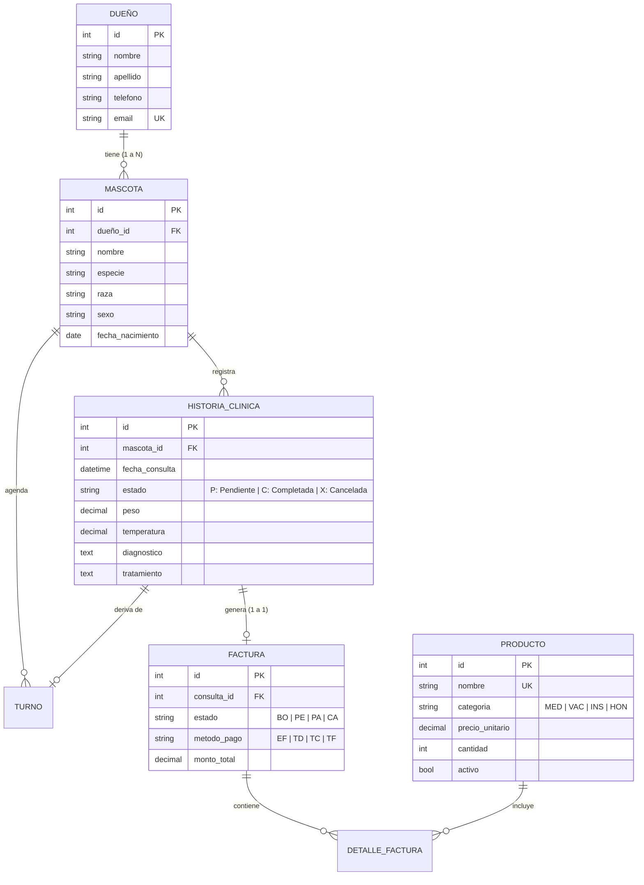

# 🐾 Sistema de Gestión para Clínica Veterinaria


Sistema web integral desarrollado como proyecto académico para la **Tecnicatura en Desarrollo de Software (4to Cuatrimestre - Backend)**. Su objetivo es centralizar y optimizar los procesos operativos, clínicos, farmacéuticos y financieros de una clínica veterinaria moderna.

---

## 📑 Tabla de Contenidos

- [Características Principales](#-características-principales)
  - [1. Núcleo Clínico y Recepción (`gestion_veterinaria`)](#1-núcleo-clínico-y-recepción-gestion_veterinaria)
  - [2. Farmacia y Control de Stock (`productos`)](#2-farmacia-y-control-de-stock-productos)
  - [3. Facturación y Punto de Venta (`pagos`)](#3-facturación-y-punto-de-venta-pagos)
  - [4. Agenda de Citas y Turnos (`turnos`)](#4-agenda-de-citas-y-turnos-turnos)
  - [5. Diseño Responsive y UI Normalizada](#5-diseño-responsive-y-ui-normalizada)
- [Modelo de Datos y Multi-Mascota](#-modelo-de-datos-y-multi-mascota)
- [Tecnologías Utilizadas](#-tecnologías-utilizadas)
- [Estructura del Proyecto](#-estructura-del-proyecto)
- [Instalación y Puesta en Marcha Local](#-instalación-y-puesta-en-marcha-local)
- [Configuración de Correo Electrónico](#-configuración-de-correo-electrónico)
- [Guía de Despliegue en Render (Cloud)](#-guía-de-despliegue-en-render-cloud)
- [Roles de Usuario y Flujo de Atención](#-roles-de-usuario-y-flujo-de-atención)
- [Equipo de Desarrollo](#-equipo-de-desarrollo)
- [Licencia](#-licencia)

---

## 🌟 Características Principales

### 1. Núcleo Clínico y Recepción (`gestion_veterinaria`)
* **Gestión de Propietarios y Pacientes:** Registro integral con validación de datos de contacto. Soporta múltiples mascotas por cada propietario (relación 1:N).
* **Cálculo de Edad en Tiempo Real:** La edad de la mascota se computa automáticamente en meses y años según su fecha de nacimiento.
* **Preconsulta y Triaje Inicial:** El operador registra signos vitales iniciales (peso, temperatura, motivo de consulta) antes de la derivación.
* **Sala de Espera Interactiva:** Semáforo de estados en vivo (`Pendiente`, `Completada`, `Cancelada`) para que los veterinarios atiendan a los pacientes en orden de llegada.
* **Historia Clínica Digitalizada:** Registro cronológico de diagnósticos, tratamientos, evoluciones y recetas de cada paciente con control de acceso.
* **Control de Acceso por Roles (RBAC):** Separación estricta de permisos entre `ADMINISTRADOR` (médico/director) y `OPERADOR` (recepción y caja).

### 2. Farmacia y Control de Stock (`productos`)
* **Catálogo Organizado:** Clasificación en 4 categorías:
  * 💊 `MED` - Medicamentos
  * 💉 `VAC` - Vacunas
  * 🩺 `INS` - Insumos Clínicos
  * 📋 `HON` - Honorarios y Servicios Veterinarios
* **Control Inteligente de Inventario:**
  * Estados automáticos: `DISPONIBLE`, `BAJO STOCK` (cantidad $\le 5$) y `AGOTADO` ($= 0$).
  * Exclusión lógica de honorarios/servicios del cálculo de inventario físico.
* **Modales de Reposición Directa:** Actualización rápida de existencias sin necesidad de formularios engorrosos.
* **Borrado Lógico (*Soft Delete*):** Permite desactivar productos descontinuados sin romper la integridad referencial de facturas pasadas.

### 3. Facturación y Punto de Venta (`pagos`)
* **Pre-facturación Automática:** Al finalizar la atención médica se genera automáticamente un comprobante en estado `BORRADOR` vinculado a la consulta.
* **Cómputo Automático de Honorarios e Insumos:** Incorporación de conceptos facturables directamente desde el catálogo de productos y servicios.
* **Gestión de Medios de Pago:** Registro y validación de cobro en Efectivo, Tarjeta de Débito, Tarjeta de Crédito y Transferencia Bancaria.
* **Inmutabilidad de Precios:** Guarda el `precio_historico` al momento exacto de la emisión para garantizar auditoría contable ante futuras variaciones de precios.

### 4. Agenda de Citas y Turnos (`turnos`)
* **Calendario Dinámico e Interactivo:** Integración con **FullCalendar v6** con vistas mensual, semanal y diaria, soporte de horarios y eventos codificados por color.
* **Check-in en 1 Clic a Sala de Espera:** Al presentarse el paciente en recepción, un solo botón marca el turno como `Atendido` y genera inmediatamente su entrada en la Sala de Espera médica.
* **Notificaciones Transaccionales por Email:** Envío automático de correo con los detalles de la cita al registrar o confirmar un turno.
* **Arquitectura Híbrida de Email:** Emite por consola en desarrollo y mediante API HTTPS con **Resend** en entornos cloud como Render.

### 5. Diseño Responsive y UI Normalizada
* **Hoja de Estilos Centralizada (`estilos.css`):** Eliminación total de bloques `<style>` repetitivos en los templates HTML, facilitando el mantenimiento y garantizando coherencia visual.
* **Compatibilidad Multi-Dispositivo:** Adaptación fluida mediante media queries para teléfonos móviles, tablets y pantallas de escritorio.
* **Componentes Adaptativos:** Grillas de formularios elásticas, tablas con desplazamiento horizontal (`.table-responsive`), botones con zonas táctiles óptimas y modales optimizados.

---

## 🗄️ Modelo de Datos y Multi-Mascota

El sistema está diseñado para que **un mismo dueño pueda tener múltiples mascotas**. Cada mascota mantiene su propio historial clínico, turnos y preconsultas independientes:



---

## 🛠️ Tecnologías Utilizadas

### Backend
- **Python:** 3.11 / 3.12
- **Framework:** Django 4.2 LTS
- **Bases de Datos:**
  - Desarrollo: MySQL / MariaDB (puerto 3306)
  - Producción: PostgreSQL (vía `dj-database-url` y `psycopg2-binary`)
- **Email Transaccional:** `django-anymail[resend]` (comunicación segura por HTTPS puerto 443)

### Frontend
- **Estructura:** HTML5 semántico con plantillas Django DTL
- **Estilos:** CSS3 nativo normalizado (`estilos.css`), diseño responsivo con Flexbox y CSS Grid
- **Librerías:** FullCalendar v6 (CDN), Bootstrap Icons

### Dependencias Principales (`requirements.txt`)
```text
Django==4.2
mysqlclient==2.2.8
asgiref==3.11.1
sqlparse==0.5.5
tzdata==2026.2
django-anymail[resend]<=12.0
```

---

## 📁 Estructura del Proyecto

```text
clinica_veterinaria/
├── clinica_veterinaria_proyecto/    # Configuración global del proyecto
│   ├── settings.py                  # Variables, DB, Email y Apps instaladas
│   ├── urls.py                      # Enrutamiento principal
│   └── wsgi.py                      # Punto de entrada para Gunicorn/Render
│
├── gestion_veterinaria/             # Módulo Central Clínico y Usuarios
│   ├── models.py                    # Dueño, Mascota, HistoriaClinica, PerfilUsuario
│   ├── views.py                     # Vistas de preconsulta, sala de espera, historias
│   ├── urls.py                      # Rutas de pacientes y consultas
│   ├── static/gestion/css/
│   │   └── estilos.css              # Hoja de estilos centralizada y responsive (v=12)
│   └── templates/gestion/           # Vistas de mascotas, dueños y salas de espera
│
├── productos/                       # Módulo de Farmacia e Inventario
│   ├── models.py                    # Producto con cálculo de stock y categorías
│   ├── views.py                     # Catálogo, reposición de stock, altas y bajas
│   ├── forms.py                     # Formularios de productos
│   ├── urls.py                      # Rutas de farmacia
│   └── templates/productos/         # Plantillas del catálogo e inventario
│
├── pagos/                           # Módulo de Caja y Facturación
│   ├── models.py                    # Factura, DetalleFactura (precio histórico)
│   ├── views.py                     # Pre-factura, cobro de caja y reportes
│   ├── urls.py                      # Rutas de facturación
│   └── templates/pagos/             # Plantillas de factura y cobro
│
├── turnos/                          # Módulo de Agenda y Notificaciones
│   ├── models.py                    # Turno con estado y vinculación a HistoriaClinica
│   ├── views.py                     # Calendario interactivo, check-in, API de eventos
│   ├── services/
│   │   └── turno_service.py         # Lógica desacoplada de turnos y correos
│   ├── urls.py                      # Rutas de agenda y API JSON
│   └── templates/turnos/            # Interfaz de FullCalendar y registro de citas
│
├── manage.py                        # CLI de gestión de Django
├── requirements.txt                 # Dependencias del proyecto
└── README.md                        # Documentación general
```

---

## 🚀 Instalación y Puesta en Marcha Local

### 1. Requisitos Previos
- Python 3.11 o superior instalado.
- Servidor MySQL o MariaDB (por ejemplo XAMPP, WampServer o servicio local en el puerto 3306).
- Git.

### 2. Clonar el Repositorio
```bash
git clone https://github.com/SergioLezcano/Clinica_Veterinaria.git
cd Clinica_Veterinaria
```

### 3. Crear y Activar el Entorno Virtual

**En Windows (PowerShell / CMD / Git Bash):**
```bash
python -m venv venv
venv\Scripts\activate
```

**En Linux / macOS:**
```bash
python3 -m venv venv
source venv/bin/activate
```

### 4. Instalar Dependencias
```bash
pip install -r requirements.txt
```

### 5. Configurar la Base de Datos Local
1. Inicie su servidor MySQL y cree una base de datos vacía:
   ```sql
   CREATE DATABASE clinica_veterinaria CHARACTER SET utf8mb4 COLLATE utf8mb4_unicode_ci;
   ```
2. Verifique la conexión en `clinica_veterinaria_proyecto/settings.py`:
   ```python
   DATABASES = {
       'default': {
           'ENGINE': 'django.db.backends.mysql',
           'NAME': 'clinica_veterinaria',
           'USER': 'root',        # Su usuario local de MySQL
           'PASSWORD': '',        # Su contraseña local de MySQL
           'HOST': '127.0.0.1',
           'PORT': '3306',
       }
   }
   ```

### 6. Ejecutar Migraciones
```bash
python manage.py migrate
```

### 7. Crear el Usuario Administrador
```bash
python manage.py createsuperuser
```

### 8. Iniciar el Servidor de Desarrollo
```bash
python manage.py runserver
```
Acceda a la aplicación desde su navegador en: **`http://127.0.0.1:8000/`**

---

## 📧 Configuración de Correo Electrónico

El sistema cuenta con un conmutador inteligente de backend de correo:

### Modo Desarrollo Local (Por Defecto)
Si no se define la variable `RESEND_API_KEY`, Django utiliza el backend de consola:
```python
EMAIL_BACKEND = 'django.core.mail.backends.console.EmailBackend'
```
*Los correos generados (como confirmaciones de turnos) se imprimen formateados directamente en la terminal, permitiendo el desarrollo y pruebas sin requerir conexión a internet ni claves externas.*

### Modo Producción (Cloud / Render)
Para habilitar envíos reales sin bloqueos de puertos SMTP tradicionales (puertos 25, 465 y 587 bloqueados por proveedores en la nube), el sistema utiliza la API REST HTTPS de **[Resend](https://resend.com/)**:
1. Obtenga una API Key gratuita en [resend.com](https://resend.com/).
2. Defina las siguientes variables de entorno:
   ```env
   RESEND_API_KEY=re_tu_api_key_aqui
   DEFAULT_FROM_EMAIL=Clínica Veterinaria <turnos@tudominio.com>
   ```
3. El sistema conmutará automáticamente a `anymail.backends.resend.EmailBackend`.

---

## ☁️ Guía de Despliegue en Render (Cloud)

Para publicar el sistema en producción utilizando **[Render](https://render.com/)**:

### 1. Paquetes Adicionales de Producción
En producción se recomienda incorporar al entorno:
```bash
pip install gunicorn whitenoise dj-database-url psycopg2-binary
```

### 2. Script de Construcción (`build.sh`)
Cree un archivo ejecutable `build.sh` en la raíz del proyecto:
```bash
#!/usr/bin/env bash
set -o errexit

pip install -r requirements.txt
python manage.py collectstatic --no-input
python manage.py migrate
```

### 3. Configurar en Render
1. Cree un **PostgreSQL Database** en Render y copie la **Internal Database URL**.
2. Cree un **Web Service** conectado a su repositorio de GitHub:
   - **Environment:** `Python 3`
   - **Build Command:** `./build.sh`
   - **Start Command:** `gunicorn clinica_veterinaria_proyecto.wsgi:application`
3. Agregue las siguientes **Environment Variables**:
   - `DEBUG`: `False`
   - `SECRET_KEY`: Una clave secreta segura para producción.
   - `DATABASE_URL`: La URL de conexión a la base de datos PostgreSQL de Render.
   - `ALLOWED_HOSTS`: `.onrender.com` (o su dominio personalizado).
   - `RESEND_API_KEY`: Su API Key de Resend para notificaciones por correo.
   - `DEFAULT_FROM_EMAIL`: Remitente validado en Resend.

---

## 👥 Roles de Usuario y Flujo de Atención

### Matriz de Roles y Permisos

| Módulo / Función | Administrador (`ADMIN`) | Operador (`OPER`) |
| :--- | :---: | :---: |
| **Recepción:** Alta de Dueños y Mascotas | ✅ | ✅ |
| **Triaje:** Preconsulta de pacientes | ✅ | ✅ |
| **Agenda:** Agendado y check-in de turnos | ✅ | ✅ |
| **Sala de Espera:** Atención médica veterinaria | ✅ | ❌ |
| **Historias Clínicas:** Diagnóstico y recetas | ✅ | ❌ |
| **Caja:** Cobro y emisión de facturas | ✅ | ✅ |
| **Farmacia:** Consulta y reposición de stock | ✅ | ✅ |
| **Administración:** Gestión de usuarios y reportes | ✅ | ❌ |

### Diagrama del Flujo de Atención

```text
                       LLEGADA DEL PACIENTE
                               │
               ┌───────────────┴───────────────┐
               ▼                               ▼
       Paciente con Turno             Paciente sin Turno
               │                               │
        [Check-in 1-Clic]             [Alta Dueño / Mascota]
               │                               │
               └───────────────┬───────────────┘
                               │
                               ▼
                         [Preconsulta]
                  (Registro de peso, temp, motivo)
                               │
                               ▼
                       [Sala de Espera]
                    (Semáforo: Pendiente)
                               │
                               ▼
                     [Atención Veterinaria]
               (Diagnóstico, receta y tratamiento)
                               │
                               ▼
                    [Cierre de Consulta]
                               │
                               ▼
                    [Pre-factura Automática]
              (Honorarios + Medicamentos aplicados)
                               │
                               ▼
                        [Caja / Cobro]
            (Efectivo, Débito, Crédito, Transferencia)
                               │
                               ▼
                       [Factura Pagada]
```

---

## 👨‍💻 Equipo de Desarrollo

Proyecto desarrollado para la cátedra de Backend:

* **Sergio Lezcano**
* **Oscar Roth**

---

## 📄 Licencia

Proyecto desarrollado con fines académicos y educativos para la **Tecnicatura en Desarrollo de Software**. Todos los derechos reservados a los autores.
